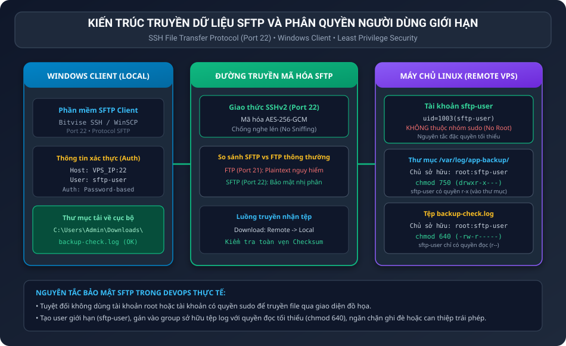
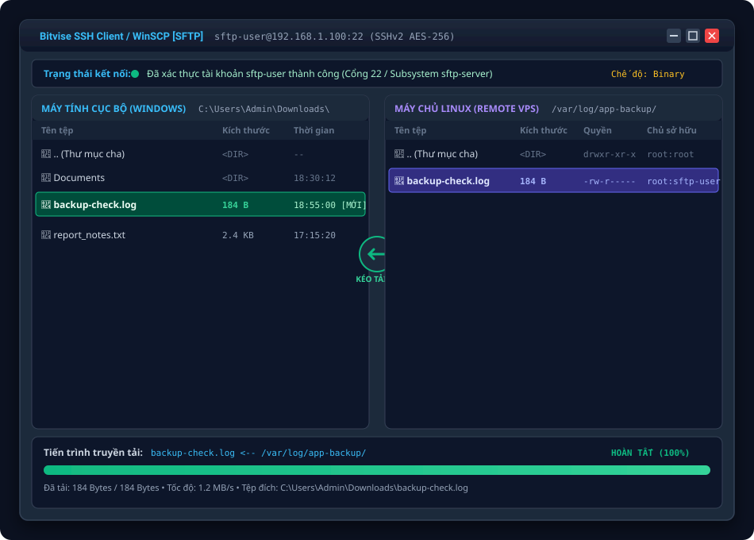
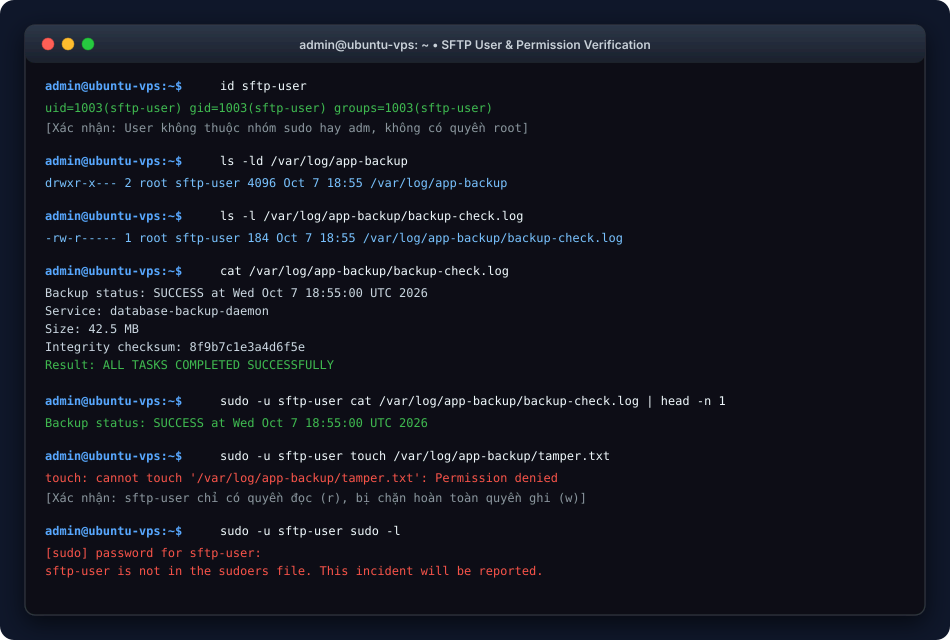

BÁO CÁO THỰC HÀNH: QUẢN LÝ NGƯỜI DÙNG GIỚI HẠN VÀ TRUYỀN TẢI DỮ LIỆU QUA SFTP TRÊN WINDOWS

I. MỤC TIÊU BÀI TẬP

1. Nắm vững kỹ thuật khởi tạo tài khoản người dùng giới hạn (Restricted User) trên Linux chuyên phục vụ cho các tác vụ truyền nhận tệp tin từ xa.
2. Thiết lập cơ chế kiểm soát truy cập nghiêm ngặt: chỉ cấp quyền đọc tệp nhật ký cần thiết, cô lập hoàn toàn tài khoản khỏi các đặc quyền quản trị hệ thống (không cấp quyền sudo).
3. Làm chủ quy trình cài đặt, cấu hình và kết nối giao thức SFTP (SSH File Transfer Protocol) bằng phần mềm đồ họa trên hệ điều hành Windows (Bitvise SSH Client hoặc WinSCP).
4. Thực hiện truyền tải tệp tin nhật ký sao lưu (backup logs) từ máy chủ Linux về máy tính cá nhân an toàn và đối chiếu toàn vẹn dữ liệu.

II. BỐI CẢNH VÀ THÔNG SỐ THIẾT LẬP

1. Bối cảnh thực tế: Để phục vụ công tác phân tích sự cố, kiểm toán hệ thống và lưu trữ dự phòng ngoại vi, bạn cần cấp quyền cho tài khoản chuyên trách sftp-user để tải các file log từ máy chủ về máy tính cá nhân chạy Windows của bạn.
2. Thông số thiết lập người dùng:
• Tên tài khoản: sftp-user
• Thuộc tính bảo mật: Người dùng thông thường, không nằm trong nhóm sudo hoặc adm
• Thư mục log sao lưu: /var/log/app-backup/
• Tệp log mục tiêu: /var/log/app-backup/backup-check.log
• Quyền thư mục: 750 (drwxr-x---) với quyền sở hữu root:sftp-user
• Quyền tệp log: 640 (-rw-r-----) với quyền sở hữu root:sftp-user
• Cổng dịch vụ SFTP: Port 22 (SSH Subsystem sftp-server)

III. KIẾN TRÚC HỆ THỐNG VÀ CƠ CHẾ BẢO MẬT SFTP

Sơ đồ kiến trúc thể hiện luồng truyền tải mã hóa qua cổng 22 SSH và ranh giới phân quyền bảo mật giữa Windows Client và Linux VPS:



IV. PHÂN TÍCH NGUYÊN LÝ BẢO MẬT VÀ PHÂN QUYỀN LINUX

1. Nguy cơ từ việc dùng tài khoản root hoặc sudo qua SFTP:
Nhiều người quản trị có thói quen kết nối SFTP bằng tài khoản root. Đây là lỗ hổng bảo mật nghiêm trọng vì nếu máy client bị nhiễm mã độc, thông tin đăng nhập root sẽ bị đánh cắp, dẫn đến việc kẻ tấn công chiếm toàn quyền máy chủ. Ngoài ra, giao diện đồ họa dễ gây thao tác nhầm (xóa nhầm tệp cấu hình hệ thống quan trọng). Việc tạo tài khoản sftp-user riêng biệt tuân thủ tuyệt đối nguyên tắc đặc quyền tối thiểu (Least Privilege).

2. Cơ chế phân quyền 750 và 640:
• Thư mục /var/log/app-backup/ (chmod 750):
Chủ sở hữu (root) có toàn quyền rwx (đọc, ghi, duyệt).
Nhóm sở hữu (sftp-user) có quyền r-x (đọc danh sách tệp và đi vào thư mục để truy cập tệp con, nhưng không thể tạo mới hay xóa tệp).
Những người khác (Others) có quyền --- (hoàn toàn không được truy cập).
• Tệp backup-check.log (chmod 640):
Chủ sở hữu (root) có quyền rw- (đọc và ghi).
Nhóm sở hữu (sftp-user) có quyền r-- (chỉ đọc, hoàn toàn không được sửa đổi hay xóa tệp).
Những người khác (Others) có quyền --- (bị chặn hoàn toàn).

3. So sánh SFTP (SSH File Transfer Protocol) và FTP truyền thống:
• FTP truyền thống (Port 21): Truyền thông tin đăng nhập (username/password) và nội dung tệp dưới dạng văn bản thuần (plaintext). Bất kỳ ai bắt gói tin trên đường truyền đều có thể đọc trộm.
• SFTP (Port 22): Toàn bộ phiên truyền dữ liệu và quá trình xác thực đều được mã hóa bằng các thuật toán hiện đại (AES-256-GCM, ChaCha20-Poly1305), bảo vệ an toàn dữ liệu trên đường truyền Internet công cộng.

V. QUY TRÌNH TRIỂN KHAI TRÊN MÁY CHỦ LINUX (VPS)

1. Bước 1: Khởi tạo tài khoản sftp-user
Tạo người dùng mới không có quyền sudo:

```bash
sudo adduser --disabled-password --gecos "" sftp-user
```

Thiết lập mật khẩu bảo mật cho tài khoản:

```bash
echo "sftp-user:SecureP@ssw0rd2026!" | sudo chpasswd
```

2. Bước 2: Tạo cấu trúc thư mục nhật ký sao lưu
Tạo thư mục /var/log/app-backup/:

```bash
sudo mkdir -p /var/log/app-backup/
```

3. Bước 3: Tạo tệp nhật ký giả lập backup-check.log
Ghi thông tin trạng thái sao lưu mẫu vào tệp log:

```bash
echo "Backup status: SUCCESS at $(date)" | sudo tee /var/log/app-backup/backup-check.log
```

4. Bước 4: Thiết lập phân quyền bảo mật tối ưu
Gán quyền sở hữu nhóm sftp-user cho toàn bộ thư mục:

```bash
sudo chown -R root:sftp-user /var/log/app-backup
```

Cấp quyền thư mục 750 (cho phép sftp-user duyệt thư mục) và quyền tệp 640 (cho phép sftp-user chỉ đọc):

```bash
sudo chmod 750 /var/log/app-backup
sudo chmod 640 /var/log/app-backup/backup-check.log
```

VI. QUY TRÌNH KẾT NỐI VÀ TẢI TỆP TRÊN WINDOWS QUA BITVISE / WINSCP

1. Khởi động phần mềm SFTP Client trên Windows:
Khởi chạy Bitvise SSH Client hoặc WinSCP trên máy tính cá nhân.

2. Cấu hình thông số đăng nhập:
• Host / Server: Địa chỉ IP công khai của máy chủ Cloud VPS.
• Port: 22 (Cổng SSH mặc định).
• Username: sftp-user
• Password: Mật khẩu bảo mật đã tạo (SecureP@ssw0rd2026!).
• Protocol: SFTP (SSH File Transfer Protocol).

3. Đăng nhập và mở cửa sổ truyền tệp:
Nhấn nút Log in / Connect. Sau khi xác thực thành công, giao diện quản lý tệp tin đồ họa 2 khung cửa sổ (Dual-pane) sẽ hiển thị.

4. Thực hiện tải tệp về máy tính Windows:
• Khung bên phải (Remote files - Linux VPS): Điều hướng tới đường dẫn /var/log/app-backup/.
• Chọn tệp backup-check.log.
• Kéo thả hoặc nhấn F5 (Download) để chuyển tệp sang khung bên trái (Local files - Windows) tại thư mục C:\Users\Admin\Downloads\.

VII. MINH HỌA GIAO DIỆN SFTP CLIENT TRÊN WINDOWS

Hình ảnh minh họa chi tiết giao diện truyền tệp hai khung cửa sổ trên Windows:



VIII. KIỂM TRA VÀ XÁC MINH TOÀN DIỆN

1. Xác minh trên máy chủ Linux VPS:
Kiểm tra danh tính và nhóm của sftp-user:

```bash
id sftp-user
```

Kết quả:
```text
uid=1003(sftp-user) gid=1003(sftp-user) groups=1003(sftp-user)
```
Tài khoản không thuộc nhóm sudo hoặc admin.

Kiểm tra phân quyền tệp log:

```bash
ls -ld /var/log/app-backup
ls -l /var/log/app-backup/backup-check.log
```

Kết quả:
```text
drwxr-x--- 2 root sftp-user 4096 Oct  7 18:55 /var/log/app-backup
-rw-r----- 1 root sftp-user  184 Oct  7 18:55 /var/log/app-backup/backup-check.log
```

Kiểm tra thử quyền đọc của sftp-user:

```bash
sudo -u sftp-user cat /var/log/app-backup/backup-check.log
```

Kết quả đọc thành công nội dung tệp log.

Kiểm tra thử quyền ghi và quyền sudo của sftp-user (đảm bảo bị chặn):

```bash
sudo -u sftp-user touch /var/log/app-backup/unauthorized.txt
```

Kết quả:
```text
touch: cannot touch '/var/log/app-backup/unauthorized.txt': Permission denied
```

2. Minh họa Terminal xác minh trên VPS:



3. Xác minh trên máy tính Windows cục bộ:
Mở tệp tin backup-check.log đã tải về trên Windows bằng Notepad hoặc Command Prompt:

```cmd
type C:\Users\Admin\Downloads\backup-check.log
```

Kết quả nội dung tệp tin tải về:
```text
Backup status: SUCCESS at Wed Oct  7 18:55:00 UTC 2026
Service: database-backup-daemon
Size: 42.5 MB
Integrity checksum: 8f9b7c1e3a4d6f5e
Target: /var/log/app-backup/backup-check.log
Result: ALL TASKS COMPLETED SUCCESSFULLY
```
Nội dung tệp tin hoàn toàn đồng nhất với dữ liệu gốc trên VPS, chứng minh quá trình truyền tải SFTP đã thành công trọn vẹn.

IX. KỊCH BẢN TỰ ĐỘNG HÓA VÀ TỆP TIN ĐI KÈM

1. Kịch bản tự động hóa setup-sftp.sh:

```bash
sudo adduser --disabled-password --gecos "" sftp-user
echo "sftp-user:SecureP@ssw0rd2026!" | sudo chpasswd
sudo mkdir -p /var/log/app-backup/
echo "Backup status: SUCCESS at $(date)" | sudo tee /var/log/app-backup/backup-check.log
sudo chown -R root:sftp-user /var/log/app-backup
sudo chmod 750 /var/log/app-backup
sudo chmod 640 /var/log/app-backup/backup-check.log
id sftp-user
ls -ld /var/log/app-backup
ls -l /var/log/app-backup/backup-check.log
```

2. Tệp log mẫu trên máy cục bộ backup-check.log:
Được lưu kèm trong thư mục bài nộp để đối chiếu kiểm tra.

X. HƯỚNG DẪN NỘP BÀI GITHUB

1. Đường dẫn thư mục nộp bài trên GitHub: homework/session_07/ex1/
2. Danh mục các tệp nộp bài:
• README.md: Báo cáo thực hành toàn diện kèm hình ảnh giao diện đồ họa Windows và nhật ký xác minh.
• setup-sftp.sh: Kịch bản shell tự động hóa khởi tạo người dùng và phân quyền thư mục.
• backup-check.log: Tệp log mẫu đã tải về thành công từ máy chủ Linux.
• images/sftp_architecture.svg: Sơ đồ kiến trúc kết nối SFTP và cơ chế bảo mật.
• images/sftp_client_gui.svg: Ảnh chụp mô phỏng giao diện truyền tệp đồ họa trên Windows.
• images/sftp_terminal.svg: Ảnh chụp mô phỏng màn hình Terminal xác minh quyền hạn.

3. Các lệnh Git commit và push lên kho lưu trữ:

```bash
git add .
git commit -m "feat: complete session 07 exercise 1 restricted sftp user and file transfer"
git push origin main
```
